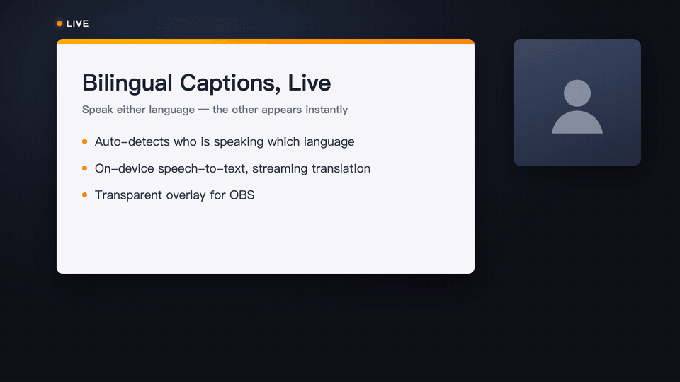
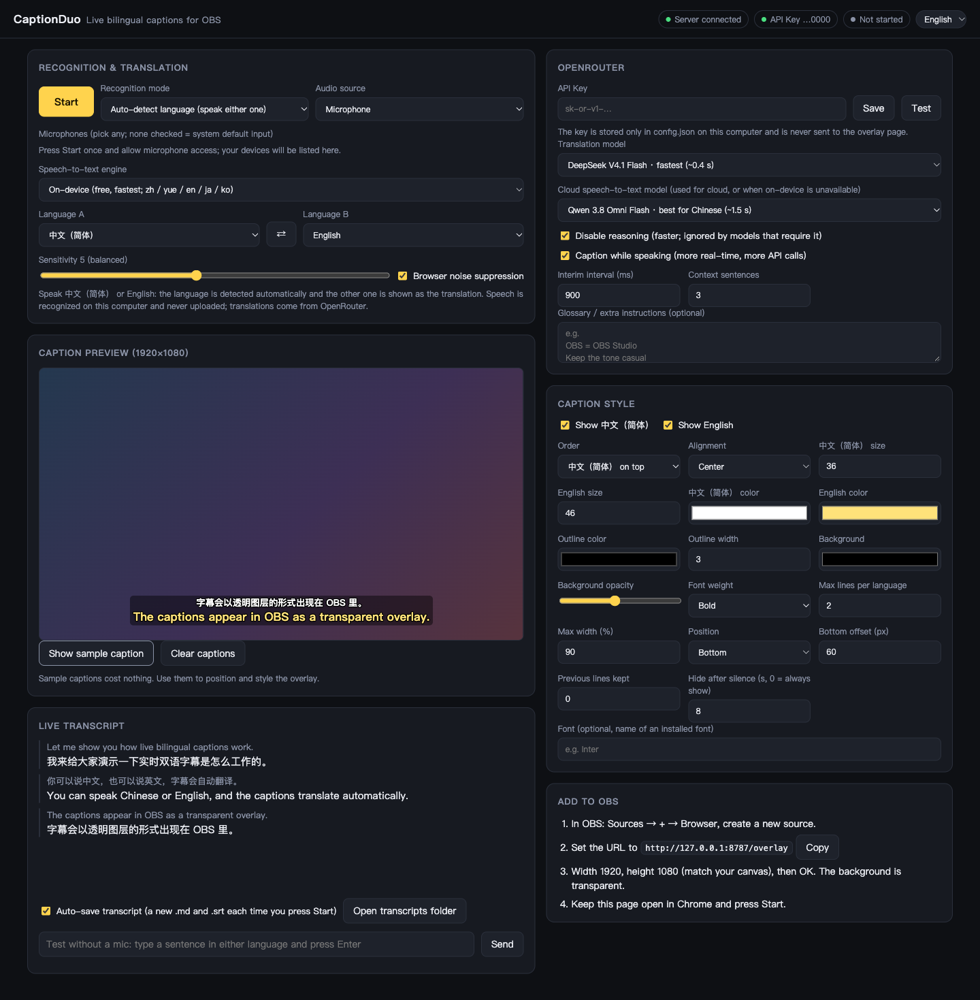

<div align="center">

# CaptionDuo

**Live bilingual captions for OBS.** Speak either of two languages and both appear on screen, the original and its translation.

English · [简体中文](README.zh-CN.md)


[](LICENSE)

[Features](#features) · [Quick start](#quick-start) · [Use it in OBS](#use-it-in-obs) · [OBS integration](#obs-integration) · [Troubleshooting](#troubleshooting)



</div>

## Features

- **Two-way, auto-detected.** Pick two languages (say, Chinese and English) and speak either. CaptionDuo works out which one you used and shows the other as the translation. Each language always keeps its own line and style.
- **Low latency.** Captions appear while you're still talking and are finalized when you pause. Translations stream in token by token.
- **On-device speech-to-text.** The optional [SenseVoice](https://github.com/k2-fsa/sherpa-onnx) model runs on your machine: free, private, and only tens of milliseconds per sentence (zh / yue / en / ja / ko). A cloud speech-to-text model is used automatically for other languages.
- **Bring your own LLM.** Translation, and cloud speech-to-text when you need it, runs on the LLM of your choice: DeepSeek, Claude, Qwen, Gemini, and more. A glossary keeps names and jargon consistent.
- **Made for OBS.** A transparent 1920×1080 browser source. Font, colors, outline, background, position and line count are all adjustable, and changes reach OBS live without a refresh.
- **Multiple microphones.** Each mic gets its own captions. When one person is picked up by two mics (crosstalk), only the louder one is kept.
- **Speech detection.** The optional Silero model listens for human voices, so keyboard clicks and game sounds don't trigger captions.
- **Corrections and blocked words.** Fixed replacement rules fix words the recognizer keeps getting wrong (on-device too) and mask profanity in both languages.
- **OBS integration.** Mute your mic in OBS and captions pause automatically. While streaming, captions can also go out as the stream's own closed captions.
- **Local translation.** Translation can run on Ollama, LM Studio or any OpenAI-compatible endpoint, even offline.
- **Transcripts saved for you.** Every session is saved as a readable `.md` file and a bilingual `.srt` you can drop into a video editor.
- **English or Chinese interface.** Switch at the top right of the control panel.

## How it works

```
Microphone ──> Control panel (Chrome: capture, voice activity detection)
                   │ audio / text
                   ▼
              server.js (127.0.0.1) ──> Speech-to-text: on-device SenseVoice (default) or a cloud audio LLM
                   │                └─> Translation: LLM (streaming)
                   ▼ Server-Sent Events
              OBS browser source /overlay (transparent captions)
```

## Quick start

**Requirements:** [Node.js](https://nodejs.org) 20.3+ (22+ to connect to OBS), Chrome or Edge, [OBS Studio](https://obsproject.com), and an API key for your LLM provider.

```bash
git clone https://github.com/coolgenerator/CaptionDuo.git
cd CaptionDuo
npm install        # optional: only needed for on-device speech-to-text and Silero speech detection
npm start          # or double-click start.command on macOS
```

1. Open <http://127.0.0.1:8787/panel> in **Chrome**. On macOS, `start.command` opens it for you.
2. Enter your LLM API key, then click **Save** and **Test**.
3. Choose **Language A** and **Language B**, click **Start**, and allow microphone access.

Keep the control panel tab open while you stream. Audio is captured in that page.

<p align="center"></p>

## Use it in OBS

1. In OBS, go to **Sources → + → Browser** and name the source, for example `Captions`.
2. Fill in the source properties:
   - **URL:** `http://127.0.0.1:8787/overlay`
   - **Width / Height:** `1920` × `1080`, or your canvas size
   - Leave everything else at its default and click **OK**.
3. Keep the caption source at the **top of the Sources list** so it draws above your screen capture and camera.
4. For the same captions in every scene, choose **Add Existing** in the other scenes and pick `Captions`. Alternatively, put it in its own scene and nest that scene in the others.
5. In the control panel, click **Show sample caption** to position and style the captions. The sample costs nothing. Adjust size, colors, **Position** (bottom or top) and the offset from that edge there; you don't need to move the source in OBS.

> [!TIP]
> If the overlay stays blank, check that the server is running and click **Show sample caption**. If it's still blank, right-click the source in OBS, open **Properties**, and click **Refresh cache of current page**.

## Recognition modes

| | Auto-detect language (default) | Chrome live recognition |
|---|---|---|
| What you can speak | Language A or B, detected automatically | Language A only |
| How text appears | Updates about every 0.35 s on-device, or every 1–2 s with cloud speech-to-text | Word by word |
| Where audio goes | Nowhere with on-device speech-to-text; to your cloud speech-to-text model with cloud | Google's speech service |
| Browser | Chrome / Edge | Chrome / Edge |

## On-device speech-to-text (optional, recommended)

CaptionDuo runs SenseVoice locally through [sherpa-onnx](https://github.com/k2-fsa/sherpa-onnx). It supports Chinese, Cantonese, English, Japanese and Korean.

1. Run `npm install` in the project folder. This installs `sherpa-onnx-node`.
2. From sherpa-onnx's [asr-models release](https://github.com/k2-fsa/sherpa-onnx/releases/tag/asr-models), download `sherpa-onnx-sense-voice-zh-en-ja-ko-yue-int8-2024-07-17.tar.bz2` (155 MB). Extract it and put `model.int8.onnx` and `tokens.txt` in `models/sense-voice/`. Don't use the 2025-09-09 package; it is a Cantonese-only fine-tune.
3. Restart the server. The startup log should say `On-device speech-to-text: ready`.

CaptionDuo falls back to cloud speech-to-text in two cases: when one of your languages isn't supported locally (for example Spanish), or when the local model hears a third language.

## Speech detection (optional, recommended)

By default CaptionDuo decides whether you're talking by volume, so keyboard clicks, game sounds or a bump on the desk can count as speech. With [Silero VAD](https://github.com/snakers4/silero-vad) installed, a model decides whether a sound is a human voice instead. That means far fewer false triggers and less fiddling with sensitivity. The model is about 2 MB and runs inside the control panel page, so audio stays on your machine.

1. Run `npm install` in the project folder. This installs `onnxruntime-web`.
2. Download [silero_vad.onnx](https://github.com/snakers4/silero-vad/raw/master/src/silero_vad/data/silero_vad.onnx) and put it in `models/silero-vad/`.
3. Restart the server. **Speech detection** in the control panel defaults to the Silero model. If it fails to load, CaptionDuo falls back to the volume threshold.

With Silero, the sensitivity slider sets the model's threshold, and the yellow line on the level meter becomes a low minimum volume that filters out distant voices, such as a video playing on your speakers.

## Corrections & blocked words

Write one rule per line under **Corrections & blocked words** in the control panel. Rules run after speech-to-text and before translation, and once more on the translation:

```
# misheard => correct; separate several spellings with | or commas
Genshin Impacts | Gin shin => Genshin Impact
# A word without => is masked as ***
damn
```

The glossary only helps cloud speech-to-text and the translation model. **Rules are the only way to correct on-device speech-to-text.** Latin-script words match whole words only (`ass` won't change `class`); Chinese, Japanese and Korean text matches anywhere. A sentence that is blocked entirely isn't captioned.

## OBS integration

Requires Node.js 22+. In OBS, open **Tools → WebSocket Server Settings**, turn on **Enable WebSocket server**, and click **Show Connect Info** to see the password. In the control panel, under **OBS connection**, tick **Connect to OBS**, enter the address (default `ws://127.0.0.1:4455`) and the password, and click **Save**.

Once connected, you can use two features:

- **Pause while muted.** Pick your microphone source from OBS. When you mute it in OBS, captions pause (no audio is uploaded and the overlay clears) and resume when you unmute. Give that source a mute hotkey in OBS and you have a global pause key.
- **Stream captions.** While you're streaming, each finalized caption is also sent as the stream's own closed captions (CEA-608), so viewers on Twitch and similar platforms can turn CC on or off, and the captions stay in the VOD. Send language A, language B, or both. CEA-608 is an old standard, and most platforms only display Latin text correctly; Chinese and Japanese usually don't show up.

## Pausing captions

The **Pause captions** button in the control panel pauses and resumes at any time. While paused, no audio is uploaded, the server drops any speech it receives, and the overlay clears. Other programs can control it too. For example, bind a global shortcut with macOS Shortcuts that runs:

```bash
curl -s -X POST -H 'Content-Type: application/json' -d '{"paused":"toggle"}' http://127.0.0.1:8787/api/pause
```

`paused` accepts `true`, `false` or `"toggle"`.

## Custom translation endpoint

Translation goes through OpenRouter by default. To translate locally (free, and it works offline), run a model in [Ollama](https://ollama.com) or LM Studio and enter its OpenAI-compatible address under **Custom translation endpoint**: `http://127.0.0.1:11434/v1` for Ollama, `http://127.0.0.1:1234/v1` for LM Studio. Then choose **Custom model ID** as the translation model and enter the model name used by that endpoint, such as `qwen3:8b`. Other OpenAI-compatible cloud services work too; put their key in **API key for that endpoint**.

Only translation uses this endpoint; cloud speech-to-text still goes through OpenRouter. Your OpenRouter key is never sent to a custom endpoint.

## Transcripts

Auto-save is on by default. You can turn it off under **Live transcript** in the control panel.

Each click on **Start** begins a new session. When the first sentence is finalized, two files are created in `transcripts/`:

- `YYYY-MM-DD_HH-MM-SS.md`: wall-clock time, original text and translation for every sentence.
- `YYYY-MM-DD_HH-MM-SS.srt`: bilingual subtitles, timed from the moment you clicked **Start**. Drop the file into your editor; if the recording started at a different time, shift the subtitles as a whole.

Transcripts stay on your computer. To change the folder, run `CAPTIONDUO_TRANSCRIPTS=/path node server.js`.

## Tips

- **Models.** Translation defaults to `deepseek/deepseek-v4.1-flash`. Cloud speech-to-text defaults to `qwen/qwen3.8-omni-flash`, which was the most accurate for Chinese in our tests; `google/gemini-3.1-flash-lite` is faster. You can switch to any model your provider offers. Speech-to-text models must accept audio input.
- **Glossary.** Add names, product terms and preferred translations under **Glossary / extra instructions**. They are added to both the translation and the speech-to-text prompts.
- **Disable reasoning** (on by default) tells models to answer without thinking first, which cuts latency a lot. If a model requires reasoning, the setting is dropped automatically.
- **Caption while speaking** shows captions before a sentence ends. Turn it off to make fewer API calls.
- **Sensitivity.** Lower it if captions appear when nobody is talking; raise it if quiet speech is missed. With the volume threshold, the yellow line on the level meter is the trigger level; with Silero, see **Speech detection** above.
- **Translating computer audio.** Choose **Tab / system audio** and enable audio sharing, or route system audio through a virtual device such as BlackHole.
- **Port.** To use a different port, run `PORT=8790 node server.js`. The server only listens on `127.0.0.1`.

## Privacy & API key safety

- Your API key is stored only in `config.json` (file mode `600`). You can also provide it through an environment variable instead.
- `config.json` and `transcripts/` are listed in `.gitignore`, so they are never committed.
- The key never leaves the server. The control panel only shows its last four characters, and the overlay page never receives it.
- The server binds to `127.0.0.1`. It rejects requests whose `Host` or `Origin` isn't local, which protects against other websites and DNS rebinding.
- With on-device speech-to-text, audio never leaves your machine. Only the recognized text is sent to your LLM provider for translation, and with a local translation endpoint not even that.
- The OBS WebSocket password and the custom endpoint's key are also kept only in `config.json`; the control panel never receives them. Your OpenRouter key is only ever sent to OpenRouter.
- While captions are paused, the control panel uploads no audio.

## Troubleshooting

| Problem | Fix |
|---|---|
| `Port 8787 is already in use` | CaptionDuo is probably already running. Close it, or start it with `PORT=8790`. |
| Not sure where CaptionDuo is running, or how to stop it | Press `Ctrl+C` in its terminal window (`start.command` opens one). Otherwise run `lsof -nP -iTCP:8787 -sTCP:LISTEN` to find its PID, then `kill <PID>`. |
| Captions in OBS stop updating, or new style options have no effect after restarting or updating CaptionDuo | Open the browser source's **Properties** in OBS and click **Refresh cache of current page**. Reload the control panel in Chrome too. |
| Captions at the top of the screen get cut off by the top edge | Set **Position** to **Top** instead of raising **Bottom offset**. Top captions then grow downward. |
| Captions come from the wrong microphone, such as the laptop's built-in mic | Check the **Using:** line shown after you click **Start**. Tick the right device under **Microphones**; with none ticked, the system default input is used. |
| The control panel says the server is an older version | Stop the server with `Ctrl+C` and start it again. The page reloads by itself. |
| Microphone permission denied | Click the icon at the left of Chrome's address bar and allow the microphone. |
| No microphones listed | Click **Start** once and grant access. Browsers hide device names until then. |
| Captions are cut off or too wide | Lower **Max width (%)** or **Max lines per language** in **Caption style**. |
| Can't connect to OBS | Check that OBS is open and the server is enabled under **Tools → WebSocket Server Settings**, that the address, port and password match **Show Connect Info**, and that you're on Node.js 22 or newer. |
| Speech detection only offers the volume threshold | `onnxruntime-web` isn't installed or `models/silero-vad/silero_vad.onnx` is missing. See **Speech detection** above. |

## Project structure

```
server.js            Local server: speech-to-text, corrections, translation, SSE broadcast, transcripts, OBS link
public/panel.html    Control panel: capture, voice activity detection, settings, preview
public/overlay.html  Transparent caption layer for the OBS browser source
start.command        macOS launcher (starts the server, opens the panel)
models/sense-voice/  Optional on-device speech-to-text model (not committed)
models/silero-vad/   Optional speech detection model (not committed)
transcripts/         Saved transcripts (not committed)
```

## License

[MIT](LICENSE)
