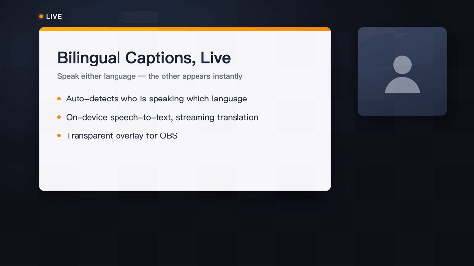
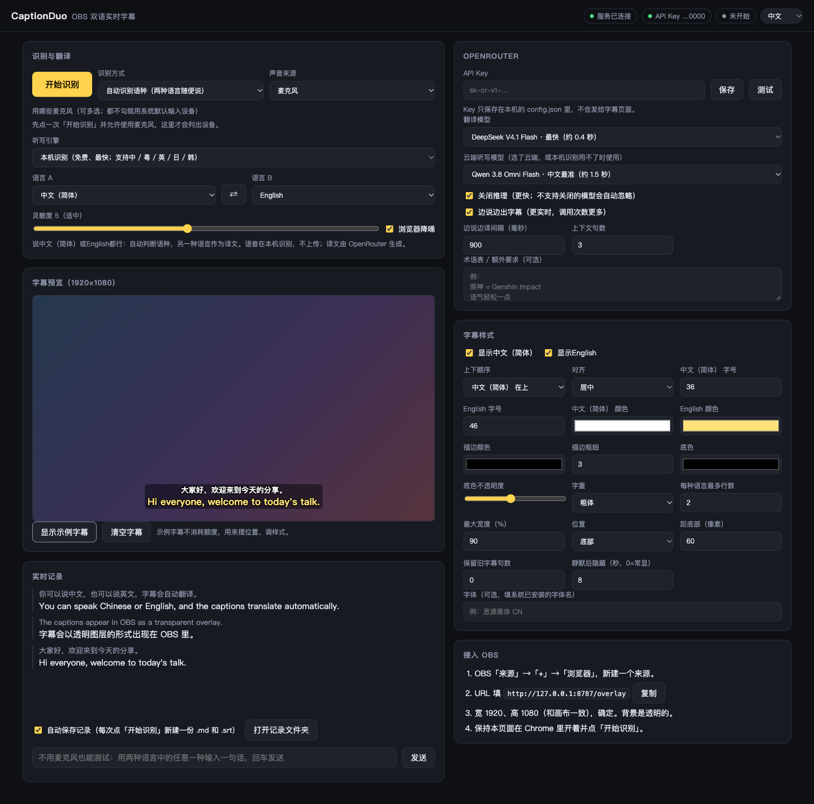

<div align="center">

# CaptionDuo

**OBS 双语实时字幕。** 两种语言随便说，画面上同时出现原文和译文。

[English](README.md) · 简体中文


[](LICENSE)

[功能](#功能) · [快速开始](#快速开始) · [在 OBS 里使用](#在-obs-里使用) · [OBS 联动](#obs-联动) · [常见问题](#常见问题)



</div>

## 功能

- **双向、自动判断语种**：选好两种语言（比如中文和英文），说哪种都行，CaptionDuo 自动判断是哪一种，另一种作为译文。每种语言固定一行、固定样式。
- **低延迟**：话没说完字幕就开始出，停顿时定稿；译文流式逐字出现。
- **本机听写**：可选的 [SenseVoice](https://github.com/k2-fsa/sherpa-onnx) 模型在本机运行，免费、音频不出本机，一句话只要几十毫秒，支持中 / 粤 / 英 / 日 / 韩。其他语言自动改用云端听写。
- **接入你自己的大模型**：翻译（以及需要时的云端听写）用你选的大模型，DeepSeek、Claude、Qwen、Gemini 等都行；术语表能让人名、行话保持一致。
- **为 OBS 设计**：透明背景的 1920×1080 浏览器源。字体、颜色、描边、底色、位置、行数都能调，改动实时同步到 OBS，不用刷新。
- **多支麦克风**：每支各自出字幕；一个人的声音被两支麦克风同时收到（串音）时，只保留更响的那一路。
- **人声检测**：可选的 Silero 模型判断「是不是人声」，键盘声、游戏音效不会触发字幕。
- **纠错与屏蔽词**：固定的替换规则，本机听写也能纠正常听错的词，脏话两种语言都能拦住。
- **OBS 联动**：OBS 里把麦克风静音，字幕就自动暂停；推流时还能把字幕作为直播流自带的 CC 发出去。
- **本机翻译**：翻译可以改走 Ollama、LM Studio 等 OpenAI 兼容接口，断网也能用。
- **自动保存记录**：每一场都会存成一份易读的 `.md` 和一份双语 `.srt`，可以直接拖进剪辑软件。
- **中英文界面**：在控制面板右上角切换。

## 工作原理

```
麦克风 ──> 控制面板（Chrome：录音、断句）
              │ 音频 / 文字
              ▼
         server.js（127.0.0.1）──> 听写：本机 SenseVoice（默认）或云端音频大模型
              │                └─> 翻译：大模型（流式）
              ▼ SSE 推送
         OBS 浏览器源 /overlay（透明字幕层）
```

## 快速开始

**需要**：[Node.js](https://nodejs.org) 20.3+（要连接 OBS 需要 22+）、Chrome（或 Edge）、[OBS Studio](https://obsproject.com)，以及一个大模型服务的 API Key。

```bash
git clone https://github.com/coolgenerator/CaptionDuo.git
cd CaptionDuo
npm install        # 可选：只有本机听写和 Silero 人声检测需要
npm start          # macOS 上也可以双击 start.command
```

1. 用 **Chrome** 打开 <http://127.0.0.1:8787/panel>。在 macOS 上用 `start.command` 启动时会自动打开。
2. 填入大模型的 API Key，点 **保存**，再点 **测试**。
3. 选好 **语言 A** 和 **语言 B**，点 **开始识别**，允许麦克风权限。

直播期间控制面板要一直开着，因为录音是在这个页面里进行的。界面默认是英文，在右上角可以切换成中文。

<p align="center"></p>

## 在 OBS 里使用

1. 在 OBS 的 **来源** 里点 **+** → **浏览器**，起个名字，比如「字幕」。
2. 填写来源属性：
   - **URL**：`http://127.0.0.1:8787/overlay`
   - **宽 / 高**：`1920` × `1080`，或者和你的画布一致
   - 其他保持默认，点 **确定**。
3. 把字幕来源放在 **来源列表的最上面**，这样它会叠在屏幕捕获和摄像头画面之上。
4. 想让每个场景都有同一份字幕：在其他场景里点 **+** → **浏览器** → **添加现有**，选「字幕」。也可以把字幕单独放进一个场景，再把这个场景嵌套进其他场景。
5. 在控制面板里点 **显示示例字幕**，对着它摆位置、调样式。示例字幕不消耗额度。字号、颜色、**位置**（底部或顶部）和离那条边的距离都在面板里调，不需要在 OBS 里拖动来源。

> [!TIP]
> OBS 里看不到字幕时，先确认服务在运行，再在面板里点 **显示示例字幕**。还是看不到的话，右键字幕来源 → **属性** → **刷新当前页面的缓存**。

## 两种识别方式

| | 自动识别语种（默认） | Chrome 实时识别 |
|---|---|---|
| 说什么语言 | A、B 随便说，自动判断 | 只能说语言 A |
| 出字方式 | 本机听写时约每 0.35 秒更新一次；云端听写时每 1～2 秒更新一次 | 逐字出现 |
| 音频发给谁 | 本机听写时不上传；云端听写时发给你选的云端听写模型 | Google 的语音识别服务 |
| 浏览器 | Chrome / Edge | Chrome / Edge |

## 本机听写（可选，推荐）

CaptionDuo 用 [sherpa-onnx](https://github.com/k2-fsa/sherpa-onnx) 在本机运行 SenseVoice，支持中文、粤语、英语、日语、韩语。

1. 在项目目录运行 `npm install`，会装上 `sherpa-onnx-node`。
2. 从 sherpa-onnx 的 [asr-models 发布页](https://github.com/k2-fsa/sherpa-onnx/releases/tag/asr-models) 下载 `sherpa-onnx-sense-voice-zh-en-ja-ko-yue-int8-2024-07-17.tar.bz2`（155 MB）。解压后把 `model.int8.onnx` 和 `tokens.txt` 放进 `models/sense-voice/`。不要用 2025-09-09 那个包，那是粤语专用的微调版。
3. 重启服务。启动信息里出现「本地听写：已就绪」就可以了。

以下两种情况会自动改用云端听写：两种语言里有本机模型不支持的（比如西班牙语），或者本机把一句话判成了第三种语言。

## 人声检测（可选，推荐）

默认按音量判断有没有在说话，键盘声、游戏音效、拍桌子也可能被当成说话。装上 [Silero VAD](https://github.com/snakers4/silero-vad) 后改由模型判断「是不是人声」，误触发少很多，也不用反复调灵敏度。模型约 2 MB，在控制面板页面里运行，音频不出本机。

1. 在项目目录运行 `npm install`，会装上 `onnxruntime-web`。
2. 下载 [silero_vad.onnx](https://github.com/snakers4/silero-vad/raw/master/src/silero_vad/data/silero_vad.onnx)，放进 `models/silero-vad/`。
3. 重启服务。控制面板的「人声检测」里会默认选中「Silero 人声模型」；加载失败时自动退回按音量判断。

用 Silero 时，灵敏度调的是模型的判断门槛；音量条上的黄线变成一条很低的最低音量，用来滤掉远处的人声（比如音箱里放的视频）。

## 纠错与屏蔽词

在控制面板「纠错与屏蔽词」里每行写一条规则。它在听写之后、翻译之前生效，译文也会再过一遍：

```
# 听错的词 => 正确写法；左边可以用 | 或逗号写几个说法
元深 | 原深 => 原神
欧比爱斯 => OBS
# 只写词、不写 => 的，打成 ***
卧槽
```

术语表只对云端听写和翻译模型起作用，**本机听写只能靠这里纠错**。英文等拉丁字母按整词匹配（`ass` 不会改掉 `class`），中日韩文字直接匹配。一整句都被屏蔽时，这句不出字幕。

## OBS 联动

需要 Node.js 22+。在 OBS 里打开 **工具 → WebSocket 服务器设置**，勾选 **开启 WebSocket 服务器**，点 **显示连接信息** 可以看到密码。然后在控制面板的「OBS 联动」里勾选 **连接 OBS**，填好地址（默认 `ws://127.0.0.1:4455`）和密码，点 **保存**。

连上之后可以用两个功能：

- **静音时暂停字幕**：选好 OBS 里的麦克风来源，在 OBS 里把它静音时字幕自动暂停（不上传音频，字幕层清空），取消静音就恢复。在 OBS 里给这个来源设一个静音快捷键，它就成了全局暂停键。
- **直播流字幕**：推流时把每句定稿的字幕作为直播流自带的字幕（CEA-608）发出去，Twitch 等平台的观众可以自己开关 CC，录播里也保留。可以只发语言 A、只发语言 B，或两种都发。CEA-608 是老标准，大多数平台只能正常显示英文等拉丁字母，中文、日文通常显示不出来。

## 暂停字幕

控制面板上的 **暂停字幕** 按钮可以随时暂停或继续：暂停期间不上传音频，服务端也会丢掉收到的语音，字幕层清空。别的程序也能控制暂停，比如用 macOS「快捷指令」绑一个全局快捷键，运行：

```bash
curl -s -X POST -H 'Content-Type: application/json' -d '{"paused":"toggle"}' http://127.0.0.1:8787/api/pause
```

`paused` 可以填 `true`、`false` 或 `"toggle"`。

## 自定义翻译接口

翻译默认走 OpenRouter。想在本机翻译（不花钱、断网也能用），可以先在 [Ollama](https://ollama.com) 或 LM Studio 里运行一个模型，然后在「自定义翻译接口」里填它的 OpenAI 兼容地址：Ollama 是 `http://127.0.0.1:11434/v1`，LM Studio 是 `http://127.0.0.1:1234/v1`。翻译模型选 **自定义模型 ID**，填这个接口里的模型名，比如 `qwen3:8b`。其他 OpenAI 兼容的云服务也能填，需要 Key 的话填在「该接口的 API Key」里。

只有翻译会改走这个接口，云端听写仍然走 OpenRouter。OpenRouter 的 Key 不会发给自定义接口。

## 自动保存记录

默认开启，可以在控制面板「实时记录」下关掉。

每次点 **开始识别** 算一场。第一句话定稿时，会在 `transcripts/` 里新建两个文件：

- `日期_时间.md`：每句话的时钟时间、原文和译文。
- `日期_时间.srt`：双语字幕，时间从点「开始识别」那一刻算起。可以直接拖进剪辑软件；录像和识别不是同时开始的话，在剪辑软件里把字幕整体平移一下。

记录只保存在本机。换目录：`CAPTIONDUO_TRANSCRIPTS=/路径 node server.js`。

## 使用建议

- **模型**：翻译默认 `deepseek/deepseek-v4.1-flash`。云端听写默认 `qwen/qwen3.8-omni-flash`，实测中文最准；想更快可以换 `google/gemini-3.1-flash-lite`。也可以换成服务商提供的任意模型，听写模型必须支持音频输入。
- **术语表**：把人名、产品名和固定译法写进「术语表 / 额外要求」。它会附在翻译和听写两边的提示词后面。
- **关闭推理**（默认开启）：让模型不要先“思考”再输出，延迟低很多。个别模型不允许关闭，会自动去掉这个参数。
- **边说边出字幕**：开启后句子没说完就开始出字幕。想省调用次数就关掉。
- **灵敏度**：没人说话也出字幕就调低；小声说话不出字幕就调高。按音量判断时，音量条上的黄线是触发门槛；用 Silero 时的含义见上文「人声检测」。
- **翻译电脑播放的声音**：选「标签页 / 系统声音」并在共享时勾选音频，或者用 BlackHole 之类的虚拟声卡。
- **换端口**：`PORT=8790 node server.js`。服务只监听 `127.0.0.1`。

## 隐私与 API Key 安全

- API Key 只保存在本目录的 `config.json` 里（文件权限 `600`），也可以改用环境变量提供。
- `config.json` 和 `transcripts/` 都在 `.gitignore` 里，不会被提交。
- Key 不会离开服务端：控制面板只显示最后 4 位，字幕页面完全拿不到。
- 服务只监听 `127.0.0.1`，并且拒绝 `Host` 或 `Origin` 不是本机的请求，防止其他网站调用和 DNS 重绑定。
- 使用本机听写时，音频不会离开你的电脑，只有识别出的文字会发给大模型服务商翻译；改用本机翻译接口后，文字也不出本机。
- OBS 的 WebSocket 密码和自定义翻译接口的 Key 同样只存在 `config.json` 里，控制面板拿不到。OpenRouter 的 Key 只发给 OpenRouter。
- 字幕暂停期间，控制面板不上传任何音频。

## 常见问题

| 问题 | 解决办法 |
|---|---|
| 提示端口 8787 已被占用 | CaptionDuo 可能已经在运行。先关掉它，或者用 `PORT=8790` 换个端口启动。 |
| 不知道 CaptionDuo 在哪儿运行、怎么关 | 在它的终端窗口里按 `Ctrl+C`（`start.command` 会打开一个）。找不到窗口就运行 `lsof -nP -iTCP:8787 -sTCP:LISTEN` 查出进程号（PID），再 `kill <PID>`。 |
| 重启或更新 CaptionDuo 后，OBS 里字幕不更新，或新加的样式选项不生效 | 在 OBS 里打开浏览器来源的 **属性**，点 **Refresh cache of current page**（刷新当前页面缓存）。Chrome 里的控制面板也刷新一下。 |
| 字幕放到画面顶部后被顶边裁掉 | 把 **位置** 选成 **顶部**，不要靠调大 **距底部** 往上顶。选顶部后字幕往下排。 |
| 识别用错了麦克风，比如用了笔记本自带的麦 | 点 **开始识别** 后看面板显示的「正在使用：」。在 **用哪些麦克风** 里勾选正确的设备；都不勾就用系统默认输入设备。 |
| 面板提示后台服务是旧版本 | 在终端按 `Ctrl+C` 停掉服务，再重新启动。页面会自动刷新。 |
| 麦克风权限被拒绝 | 点 Chrome 地址栏左侧的图标，允许使用麦克风。 |
| 麦克风列表是空的 | 先点一次 **开始识别** 并授权。授权之前浏览器不提供设备名。 |
| 字幕被截断或太宽 | 在「字幕样式」里调小 **最大宽度（%）** 或 **每种语言最多行数**。 |
| 连不上 OBS | 确认 OBS 开着，并且「工具 → WebSocket 服务器设置」里开启了服务器；地址、端口、密码和「显示连接信息」里的一致；Node.js 版本是 22 或更新。 |
| 人声检测只能选「按音量判断」 | 还没装 `onnxruntime-web`，或者 `models/silero-vad/silero_vad.onnx` 不存在。见上文「人声检测」。 |

## 项目结构

```
server.js            本地服务：听写、纠错、翻译、SSE 推送、保存记录、OBS 联动
public/panel.html    控制面板：录音、人声检测、断句、设置、预览
public/overlay.html  OBS 浏览器源用的透明字幕层
start.command        macOS 启动脚本（启动服务并打开控制面板）
models/sense-voice/  可选的本机听写模型（不提交）
models/silero-vad/   可选的人声检测模型（不提交）
transcripts/         保存的记录（不提交）
```

## 许可证

[MIT](LICENSE)
